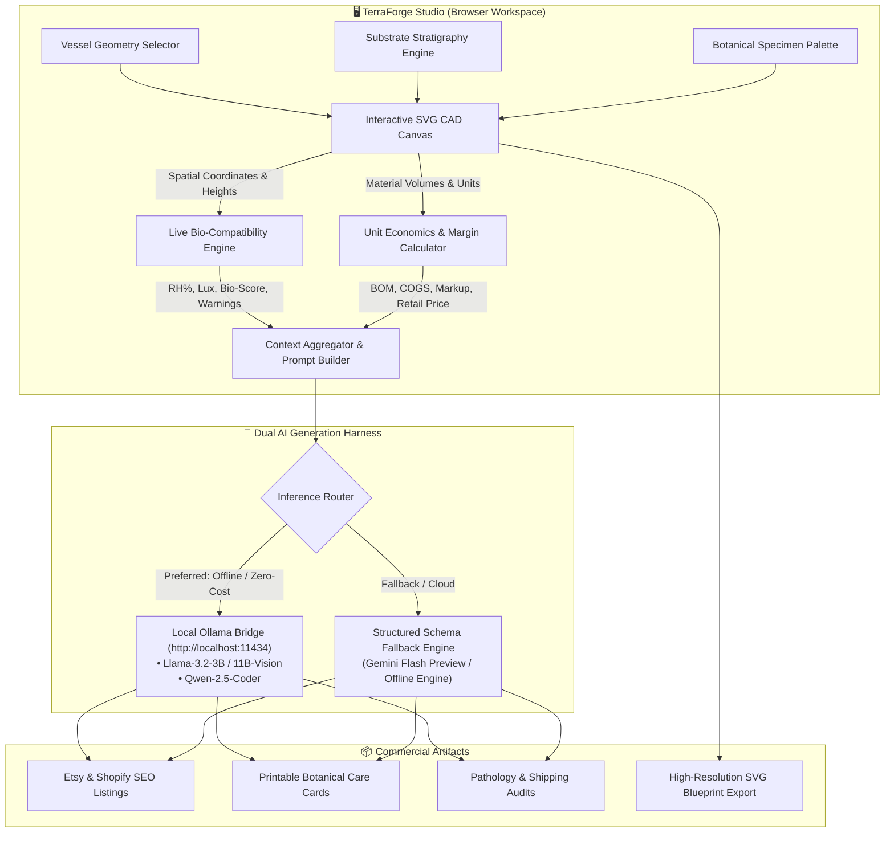

# 🌱 TerraForge Studio

> **Interactive Terrarium CAD, Real-Time Microclimate Bio-Simulator & Local Open-Weight AI Side-Hustle Operating System**

[](https://opensource.org/licenses/MIT)
[-emerald?logo=ollama)](https://ollama.ai)
[](#-commercial-unit-economics--margin-engine)
[](#-technical-architecture)
[](#)

---

## 📌 Executive Summary

**TerraForge Studio** is an all-in-one computer-aided design (CAD) workspace, biological compatibility engine, and automated e-commerce co-pilot created specifically for artisan terrarium makers, micro-botanical studio owners, and plant side-hustlers.

Boutique bio-active terrariums are high-margin, artisan products frequently sold at weekend farmers' markets, pop-up events, and craft marketplaces like Etsy and Shopify. However, builders face critical pain points:
1. **Biological Trial-and-Error:** Improper substrate layering (missing false bottoms, insufficient activated charcoal) causes root rot and ecosystem collapse.
2. **Proprietary Margin Exposure:** Handcrafters source rare botanical clippings and wholesale glassware; sending trade secrets and wholesale Bills of Materials (BOM) to cloud SaaS tools leaks private pricing.
3. **Cloud Subscription Fatigue:** A $29–$49/month recurring cloud AI subscription severely cuts into small artisan craft margins, and requires Wi-Fi in basements or outdoor weekend markets.
4. **General LLM Hallucinations:** Cloud LLMs often give inaccurate botanical advice (e.g., advising customers to seal desert succulents inside high-humidity closed glass).

**TerraForge Studio resolves this by uniting a real-time vector CAD canvas with deterministic biological guardrails and a local, zero-marginal-cost open-weight AI harness (powered by Ollama with Llama 3.2 / Qwen 2.5).**

---

## 🏗️ Architecture Overview

The application follows an offline-first, client-driven reactive pipeline that fuses deterministic physics/biology rules with local machine intelligence:



---

## 🚀 Key Modules & Capabilities

### 1. 🌿 Interactive Vector CAD & Stratigraphy Stage
* **5 Architectural Glass Vessels:** Geometric Wardian Case, Victorian Apothecary Jar, Erlenmeyer Bio-Flask (2000ml), Wide Botanical Bowl, and Modern Gallery Cylinder.
* **Millimeter-Accurate Substrate Stratigraphy:**
  * **LECA Expanded Clay:** False bottom drainage reservoir to prevent soggy roots.
  * **Activated Horticultural Charcoal:** Micro-porous anti-fungal toxin trap and odor neutralizer.
  * **Long-Fiber Sphagnum Moss:** Organic mesh barrier preventing soil from sifting into drainage pebbles.
  * **ABG Bio-Active Tropical Mix:** Tree fern fiber, coco coir, orchid bark, and worm castings.
  * **Silica Sand Top-Dress:** Aesthetic geological accent layer.
* **Specimen Palette:**
  * **Flora:** Pink Angel Fittonia, Cushion Moss (*Leucobryum glaucum*), Dwarf Maidenhair Fern, Emerald Ripple Peperomia, Marcgravia Shingle Vine, and Arid Echeveria.
  * **Hardscape:** Mini Seiryu Dragon Stone, Twisted Azalea Driftwood.
  * **Micro-Fauna (Clean-Up Crew):** Temperate White Springtails (*Folsomia candida*), Rubber Ducky Isopods (*Cubaris sp.*).
* **Interactive Controls:** Free-form drag-and-drop repositioning, real-time scaling (0.5x–1.8x), rotation (-45° to +45°), horizontal mirroring, z-index layering (Bring Front / Send Back), and one-click blueprint SVG export.

---

### 2. 🔬 Deterministic Bio-Compatibility & Microclimate Simulator
* **Dynamic Relative Humidity (RH%) Engine:** Models internal moisture balance based on vessel neck aperture, cork lid seal status, substrate water holding capacity, and plant transpiration.
* **Grow Light Lux Monitoring:** Real-time photoperiod and lux calculation against shade-loving bryophytes and ferns.
* **Automated Pathology Checks:**
  * Detects missing drainage false bottoms (<18mm LECA + charcoal) and flags root rot hazards.
  * Identifies biome conflicts (e.g., placing desert succulents in a 90% RH sealed glass enclosure).
  * Verifies micro-fauna biological load balance to ensure natural mold prevention.
* **Live Ecosystem Health Score:** Produces an instant 0–100% viability rating before the builder cuts living plants.

---

### 3. 💰 Commercial Unit Economics & Margin Engine
* **Dynamic Bill of Materials (BOM):** Aggregates exact raw material wholesale costs for the selected glass vessel, substrate volume depths, and living flora/fauna specimens.
* **Labor & Packaging Buffers:** Adjustable labor slider ($5–$45) accounting for delicate artisan assembly and courier-safe cushioning.
* **Markup Multiplier:** Target retail multiplier (1.5x–3.5x) to optimize for retail, farmers' markets, or wholesale consignment.
* **Instant Profitability Telemetry:** Real-time computation of:
  $$\text{Retail Price} = (\text{COGS}_{\text{raw}} + \text{Labor}) \times \text{Multiplier}$$
  $$\text{Net Profit} = \text{Retail Price} - \text{COGS}_{\text{raw}} - \text{Labor}$$

---

### 4. 🤖 Local Open-Weight AI Side-Hustle Co-Pilot
* **100% Private Supplier Confidentiality:** Keeps wholesale supplier pricing and exact margins strictly on the maker's device.
* **Zero Marginal Cost:** Free inference powered by local hardware using **Ollama** (`llama3.2:3b`, `llama3.2-vision:11b`, `qwen2.5:7b`).
* **Offline Operation:** Works reliably in basements, greenhouses, and outdoor markets with zero internet connectivity.
* **Three Automated Business Deliverables:**
  1. **Etsy / Shopify SEO Listing:** Generates high-conversion listing titles, emotional sensory hooks, feature bullet points, and 13 algorithmic Etsy tags.
  2. **Botanical Care Passport:** Generates printable, customer-facing care cards detailing watering cycles, light tolerances, condensation interpretation, and bioactive organism notes.
  3. **Pathology & Longevity Audit:** Runs an automated pre-delivery health diagnostic with safe packaging instructions for courier shipping.

---

## 🛠️ Quick Start & Local Execution

TerraForge Studio is lightweight, zero-dependency, and ready to run immediately.

### Option A: Direct Web Server (Recommended)

#### Using Python 3:
```powershell
# Navigate to the workspace
cd terraforge-studio

# Start the local HTTP server
python -m http.server 8080
```
Open **[http://localhost:8080](http://localhost:8080)** in your browser.

#### Using Node.js:
```powershell
npx serve -l 8080 .
```

---

### Option B: Connecting Local Ollama for Free Local AI Inference

To enable offline, zero-cloud AI inference directly from your local GPU:

1. **Install and run Ollama** (from [ollama.com](https://ollama.com)).
2. **Launch Ollama with cross-origin access enabled:**
   ```powershell
   $env:OLLAMA_ORIGINS = "*"
   ollama serve
   ```
3. **Pull your preferred open-weight model:**
   ```powershell
   ollama pull llama3.2:3b
   # or
   ollama pull qwen2.5:7b
   ```
4. Open TerraForge Studio, click the **"Local Ollama"** switcher in the top navigation, and click **"Ping Local Ollama"** to connect!

*(Note: If Ollama is not running, the studio automatically switches to the built-in deterministic generation engine with seamless zero-downtime execution).*

---

## 📁 Modular Repository Structure

```text
terraforge-studio/
├── index.html                   # Semantic entry point with Tailwind & glassmorphism layout
├── assets/
│   ├── css/
│   │   └── style.css            # Custom animations, glassmorphic panels, and range styling
│   └── js/
│       ├── catalog.js           # Vessel specs, substrate definitions & botanical palette
│       ├── state.js             # Reactive application state, drag tracking & presets
│       ├── vector-engine.js     # SVG vector art renderers, canvas transforms & blueprint export
│       ├── bio-simulator.js     # Microclimate RH% calculations & pathology diagnostics
│       ├── economics.js         # Real-time BOM costing, labor buffers & retail margins
│       ├── ai-copilot.js        # Ollama local bridge, structured schema generators & prompt chips
│       └── app.js               # UI tab routing, event orchestration, modal controls & bootstrap
├── .gitignore                   # Production git exclusion rules
├── LICENSE                      # MIT Open-Source License
└── README.md                    # Comprehensive architectural and user documentation
```

---

## 📊 Technical Specifications

| Component | Technology | Rationale |
| :--- | :--- | :--- |
| **Frontend Core** | Vanilla ES6+ & Reactive DOM | Instant startup, zero build-step overhead, zero node_modules bloat |
| **Rendering Canvas** | SVG 2.0 with Dynamic ClipPaths | Resolution-independent vector export, crisp display at any scale |
| **Styling** | Tailwind CSS + Custom Glassmorphism | Elegant botanical aesthetic tailored for artisan luxury branding |
| **Local AI Engine** | Ollama HTTP Bridge | Zero API cost, private COGS data, offline mobile capability |
| **Fallback Engine** | Structured JSON Engine | Deterministic, graceful degradation without breaking user flows |
| **Typography** | Fraunces, Plus Jakarta Sans, JetBrains Mono | Botanical editorial look combined with technical precision |

---

## 🌿 Open-Source Philosophy & Community

TerraForge Studio was designed around the principle that **open-source AI democratizes craft micro-enterprises**:
* Small businesses should not be forced to pay tax on every customer interaction via closed SaaS APIs.
* Sensitive trade secrets and supplier cost structures should never leave the artisan's hardware.
* Physical sciences (botany, thermodynamics, microclimates) should govern AI prompt outputs to prevent biological failure.

---

## 📄 License

This project is open-source under the **[MIT License](LICENSE)**. Feel free to fork, customize, and deploy it for your own botanical studio or craft commerce venture.

